# Taurus AI Shell

An agent harness that works with any model provider: local Ollama, anything
OpenAI-compatible, Anthropic, or Google Gemini. It's Rust underneath, with two
frontends on one shared core: a Tauri v2 desktop app and a `taurus` CLI. One
codebase covers macOS, Windows, and Linux.

Point it at a workspace and it:

- reads and edits files, runs commands, and searches the web
- connects to MCP servers and delegates to sub-agents
- reads screenshots you paste in
- leaves itself notes, so your next conversation in that workspace doesn't
  start from nothing
- finds code by what it does, not only by what it's called
- writes down procedures it works out as reusable **skills**, which you approve
  before they're kept
- reads the `AGENTS.md` and `CLAUDE.md` you already have, so you don't need a
  seventh copy

Every write shows up as a diff before you approve it. Every file it edits is
recorded first, so you can **rewind** any turn, or read it back as a diff and
**commit it on its own**.


A turn folds its tool calls into one card, so a nine-step turn reads as one
step of the conversation. Results you're meant to *look* at, like a table or a
chart, sit on their own beside the text instead of inside that card. When a
decision is really yours, it asks and waits instead of guessing. You can skip
any question, and "You decide" answers all of them at once, so a turn never
hangs on an answer that isn't coming.

More of the interface is under [Screenshots](#screenshots).

## Quick start

There are three ways in. The first needs nothing but the download. The second
needs Rust. The third needs everything.

### 1. Download the app

Each tagged release attaches installers for all three platforms to
[GitHub Releases](https://github.com/Lukeus/taurus/releases/latest):

| Platform | File |
|---|---|
| macOS (Apple Silicon and Intel) | `.dmg` |
| Linux | `.AppImage`, `.deb`, or `.rpm` |
| Windows | `.msi`, or the `-setup.exe` installer |

An installed copy updates itself from the same releases.

### 2. Install only the CLI

The CLI needs Rust 1.89 or newer and a C compiler, and nothing else. It does
not need Node, pnpm, the Tauri prerequisites, or the speech engine's CMake:
dictation and reading aloud are desktop features, so none of that is compiled.

```bash
cargo install --path crates/taurus-cli

taurus repl                                     # interactive
taurus run "summarize the modules in src/"      # one-shot
taurus run --json "count the rust files" | jq   # for scripts
taurus rewind --to last                         # undo what the last turn wrote
taurus fork --at last                           # try it again, keeping the first try
taurus plugin add <folder or git URL>           # a Claude Code plugin, as it is
taurus memory add "staging has the migration"   # tell the next conversation something
```

### 3. Build the desktop app from source

You need:

- **Rust** 1.89 or newer
- **Node** 22 or newer
- **pnpm** 12. Older versions don't read the build and override settings in
  [`pnpm-workspace.yaml`](pnpm-workspace.yaml).
- the [Tauri prerequisites](https://v2.tauri.app/start/prerequisites/) for
  your platform
- **CMake**, for the whisper.cpp speech engine, plus whatever else your
  platform needs for it:
  - **macOS:** `brew install cmake`. libclang comes with Xcode's command line
    tools.
  - **Windows:** `winget install Kitware.CMake`. Nothing else: Windows builds
    use checked-in bindings, not libclang.
  - **Linux:** `cmake`, `libclang-dev`, and the ALSA headers
    (`libasound2-dev` on Debian and Ubuntu).

See [the speech engine](docs/development.md#the-speech-engine) if the build
stops in `whisper-rs-sys`.

```bash
pnpm install
pnpm tauri dev
```

### A model to talk to

The quickest model to try it with is a local one. Start Ollama and pull a
model that can call tools:

```bash
ollama serve                # in another terminal
ollama pull qwen3:8b
```

That's all the configuration a first run needs. With no `--model`, Taurus uses
the model you used last, and otherwise the provider's first. A model without
native tool calling still calls tools; see
[Provider-agnostic, concretely](#provider-agnostic-concretely).

The app and the CLI both use `~/.taurus`, so they share providers, skills, and
the permission allowlist. Approve a tool once in the app and your scripted runs
inherit it.

To use a hosted model instead, see [Configuration](docs/configuration.md).

## What is different about it

Most of [What it does](#what-it-does) exists in some form in every agent
harness. These are the parts that don't. Each one comes with a limit, and
[Known gaps](docs/known-gaps.md) spells those out in full.

**It's built for the model on your own machine, not only one in a
datacenter.** Every decision here is shaped around an 8k context window:

- A fifty-skill library costs one line per skill in the prompt. A procedure
  loads only when it's needed.
- The plan is rebuilt at the *tail* of every request, not in the system
  prompt. Ticking a checkbox invalidates one line of prompt cache instead of
  the tools and the whole conversation. On the same three-step task, that took
  75 seconds against 194.
- On a hosted model the same discipline is a smaller bill. The conversation
  is read back from the provider's prompt cache, not re-sent at full price,
  and a 200,000-token working context keeps a million-token model from
  re-sending 900,000 tokens on every step. Compaction summaries and
  sub-agents are counted in the conversation that asked for them, split by
  the model that spent them.
- Tool schemas are slimmed on the way out, and old tool results shrink before
  anything gets summarized.
- A long turn can start over from a brief instead of being summarized
  (`context_strategy: relay`, off by default). The harness writes most of the
  brief itself: the request, the files changed, the commands run and how they
  ended. Only what the model learned comes from the model.
- A model with no tool-calling API still calls tools, through prompted parsing.
  The core can't tell that path from the native one.

It won't turn a small model into a large one. It makes a small one affordable
to actually run an agent on. See
[the context window](docs/working-with-it.md#the-context-window).

**One core, two frontends, one state directory.** The desktop app and the
`taurus` CLI are the same agent. `Host::build_agent` is the only place a
session gets assembled. A frontend holds no agent logic, just the way it asks
you for permission. That means:

- A tool you approve in the app is approved for your scripted runs.
- A conversation started in one can be resumed in the other.
- The agent loop is tested against a scripted provider, with no GUI involved.

They're not identical surfaces, though. Reading a turn back as a diff and
committing it are app features, and the terminal dock is desktop-only on
purpose. See [How it is put together](#how-it-is-put-together).

**Undo covers what a command did, not only what a tool declared.** `edit_file`
can say which file it's about to change. A command line can't. So Taurus reads
the workspace before every command and again when it finishes, and the
difference is the answer. A `sed -i` across a dozen files, an `rm` that took
the wrong directory, a script the model wrote and ran: all of it comes back,
from the files as they were before it ran.

You don't need git, and it works for a command left running in the background
across turns. Read the same log forwards and you get a diff of any turn, plus
the option to commit that turn on its own.

The limit: two things can't be restored, and it tells you before you press
anything. Those are `.git`'s own state, and anything under a directory an
ignore rule excludes. See [Rewinding a turn](docs/safety.md#rewinding-a-turn).

**It reads the configuration you already have, and never writes to it.** That
includes:

- `AGENTS.md`, `CLAUDE.md`, `.github/copilot-instructions.md`, and Copilot's
  scoped `*.instructions.md`
- skills from `.claude/skills`, `.copilot/skills`, and `.github/skills`
- sub-agents from Claude's and Copilot's own directories
- MCP servers in the `mcpServers` format Claude Desktop uses
- plugins in Claude Code's layout: their skills, agents and MCP servers

A borrowed file is read and never rewritten. If you retune a Copilot agent,
Taurus saves its own copy beside the original, and that copy takes precedence.
The original is committed, Copilot is still reading it, and it carries keys
Taurus has never heard of.

The limit: borrowing isn't emulation. An `applyTo` glob becomes a sentence in
the prompt, because Taurus assembles the brief once per turn instead of
attaching it when a matching file is touched. See
[Instructions](docs/capabilities.md#instructions).

**A repo you just cloned doesn't get to configure your agent.** A workspace's
`.taurus` can start processes, name the endpoint your conversation is sent to,
and carry standing permission grants. All of it arrives with `git clone`.

So an untrusted workspace contributes *no* config at all. That's one rule, and
it only goes one way. You're asked only when the folder actually holds
something, and you see the MCP command lines themselves, not just a count.

The limit: it's not a sandbox. It decides whether a project can configure
Taurus, not what running that project's build script does. See
[Trusting a workspace](docs/safety.md#trusting-a-workspace).

**A data file is a surface, not a wall of text in the context window.** Handing
a million-row CSV to `read_file` is about the most expensive mistake an agent
can make. Taurus loads it as a table instead:

- It profiles every row, not a sample.
- You ask questions in SQL. Each query is planned first and refused if it does
  anything but read.
- The rows go on a pane of their own and never into a tool result.

A transformation worth keeping becomes a recipe. That's SQL committed with
your code, which you can re-run on next month's export, and which reports what
each step did to the row count.

The limit: you're committing to a dialect. A recipe is DataFusion's SQL in a
file in your repo. See
[Working with data](docs/working-with-it.md#working-with-data).

## What it does

One line each, so you can tell from this page whether the thing you want
exists. Each name links to the section that covers it properly.

### [Capabilities](docs/capabilities.md)

What it reaches for, and what it writes down.

| Feature | What it is |
|---|---|
| [Instructions](docs/capabilities.md#instructions) | Reads the `AGENTS.md`, `CLAUDE.md` and Copilot instructions you already have. |
| [Skills](docs/capabilities.md#skills) | Works a procedure out once, writes it down, and asks before keeping it. Write your own in the app, or open any skill to change it. |
| [Memory](docs/capabilities.md#memory) | Notes for the next conversation in this workspace. You can read, change and forget every one, and write your own. |
| [Sub-agents](docs/capabilities.md#sub-agents) | A scoped context with its own tools, so a search that would fill the window happens somewhere else. |
| [Slash commands](docs/capabilities.md#slash-commands) | One namespace for skills, sub-agents, and built-ins. |
| [The canvas](docs/capabilities.md#the-canvas) | A file open beside the conversation, with the lines the model means selected. Select a passage and **Ask about this** sends the selection with your message. You can edit it too: if Taurus changes a file you've been typing in, both versions are kept and you choose, and a save never overwrites a version it hasn't seen. |
| [The terminal](docs/capabilities.md#the-commands-you-ran) | Your own shell at the bottom of the window (<kbd>Ctrl</kbd>+<kbd>`</kbd>). Each command gets a pass or fail mark, **Ask Taurus** drafts a message from a command and its output, and the model can read your recent commands while the dock is open. |

### [Permission, and undo](docs/safety.md)

What it asks before acting, and how you put things back afterwards.

| Feature | What it is |
|---|---|
| [Permissions](docs/safety.md#permissions) | Every write shows up as a diff before you approve it. Remember a decision for this project or for everywhere. |
| [Checked as it's written](docs/working-with-it.md#checked-as-its-written) | After each edit, the language server you already have installed says what broke, in the result the model reads next. Only in a trusted workspace. |
| [Hooks](docs/configuration.md#hooks) | Your own programs, run at fixed points in a turn. A hook can refuse a call but never approve one. |
| [Trusting a workspace](docs/safety.md#trusting-a-workspace) | A cloned repo's config does nothing until you say so. The prompt names what's *in* those files, including what you can't see by looking: a byte that renders as nothing, a hidden comment, base64 in a file that should hold prose. |
| [Running commands](docs/safety.md#running-commands) | A real PTY on each platform, so a program that checks `isatty` behaves the way it does in your terminal. |
| [Commands that keep running](docs/safety.md#commands-that-keep-running) | A cold build, a test suite, or a dev server is started and left alone instead of waited on. What it changes is still undoable. |
| [Rewinding a turn](docs/safety.md#rewinding-a-turn) | Every file a turn touches is recorded first, so you can undo any turn. |
| [Forking a turn](docs/safety.md#forking-a-turn) | Try a turn again, another way or on another model, and switch back to the first attempt with its files. Compare two branches without switching. |
| [Keeping a turn](docs/safety.md#keeping-a-turn) | Read a turn back as a diff and commit it on its own. |
| [Reviewing a turn](docs/safety.md#reading-it-back-to-somebody-who-did-not-write-it) | Hand that diff to an agent that has seen none of the conversation. It can read but not write, and it can't know what you asked for. That's the point, and also the cost. |

### [Working with it](docs/working-with-it.md)

What a turn looks like in use.

| Feature | What it is |
|---|---|
| [Sessions](docs/working-with-it.md#sessions) | Transcripts on disk, per workspace, replayable. |
| [Finding a conversation](docs/working-with-it.md#finding-a-conversation) | ⌘K finds every panel and action by name, conversations by title, and transcripts by what was said, and opens a conversation *at* the hit. |
| [Planning a long task](docs/working-with-it.md#planning-a-long-task) | A plan it pins and keeps current, not one it announces once and forgets. |
| [Showing it a picture](docs/working-with-it.md#showing-it-a-picture) | Paste a screenshot in. |
| [Talking instead of typing](docs/working-with-it.md#talking-instead-of-typing) | Speech becomes text on your own computer, in the box for you to check. The audio is never saved or sent anywhere. |
| [Hearing replies read aloud](docs/working-with-it.md#hearing-replies-read-aloud) | Each reply read as it streams, prose only. Your computer's voice, ElevenLabs, or anything shaped like OpenAI's speech endpoint. |
| [Finding code by what it does](docs/working-with-it.md#finding-code-by-what-it-does) | Local semantic search, with the model run in-process or on your own server. |
| [When a turn stops](docs/working-with-it.md#when-a-turn-stops) and [the context window](docs/working-with-it.md#the-context-window) | What ends a turn, and what it costs. The meter above the composer breaks it down per tool, flags exact repeat calls, and shows what every request pays before the conversation starts. |
| [Tables, charts, diagrams, and questions](docs/working-with-it.md#tables-charts-diagrams-and-questions) | Results you're meant to look at, including sequence and flow diagrams, beside the text. Questions wait for you, and any can be skipped. |
| [Code is colored, and so is a diff](docs/working-with-it.md#code-is-colored-and-so-is-a-diff) | One palette for fences, diffs and the query box. A rewritten line marks the characters that actually changed. |
| [Motion that says what it is doing](docs/working-with-it.md#motion) | A waveform shaped by the kind of work in progress, not a spinner that only says the turn is alive. |
| [Working with data](docs/working-with-it.md#working-with-data) | A CSV loaded as a table on its own pane, profiled from every row and queried in SQL. A query the model ran comes with **Run in Query**, and a failed query offers itself back with the error in the message. |
| [Recipes](docs/working-with-it.md#recipes) | A chain of SQL steps committed with your code, re-runnable on next month's export, reporting what each step did to the row count. |
| [A query box that knows your columns](docs/working-with-it.md#writing-the-query) | Completion from the real schema of every loaded file. A column two files share is marked `joins`. |
| [Notes](docs/working-with-it.md#notes) | Plain Markdown files: project notes in `.taurus/notes/`, committed with the repo, and global ones in `~/.taurus/notes/`. A ```` ```mermaid ```` block is drawn by the app's own engines, offline, and says what it couldn't draw. Excalidraw **sketches** sit in the same notebook and embed with one line of Markdown. The model reads and writes notes by name, and asks before writing. |

### [Configuration](docs/configuration.md)

Providers, keys, MCP servers, and web search.

| Feature | What it is |
|---|---|
| [Providers](docs/configuration.md) | Local Ollama, anything OpenAI-compatible, Anthropic, or Google Gemini. Keys live in the OS keychain or an env var, never in a config file. |
| [Sending jobs to other models](docs/configuration.md#sending-jobs-to-other-models) | Sub-agents, reviews and drafts each on their own provider and model, so a cheap or local one does the small work. |
| [OpenAI's reasoning models](docs/configuration.md#openais-reasoning-models) | Tools called while they reason, over the Responses API. |
| [MCP servers](docs/configuration.md#mcp-servers) | Add and test them in the app, in the `mcpServers` format Claude Desktop uses. |
| [Plugins](docs/configuration.md#plugins) | Skills, sub-agents, MCP servers and hooks under one name, in Claude Code's layout, from a folder or a git URL. |
| [Themes](docs/configuration.md#themes) | Colors, typefaces, a wordmark and logo, radius and insets, in a file you can commit. A workspace can carry its own. |

Everything the Settings drawer writes is a plain file the CLI reads too.

**[Development](docs/development.md)**: tests, the live checks, the app icon,
regenerating the screenshots, and cutting a release.

**[Known gaps](docs/known-gaps.md)**: what it doesn't do, written down so you
can read about it before you run into it.

## Screenshots

<details>
<summary><b>The conversation</b>: light theme, questions</summary>

| | |
|---|---|
| 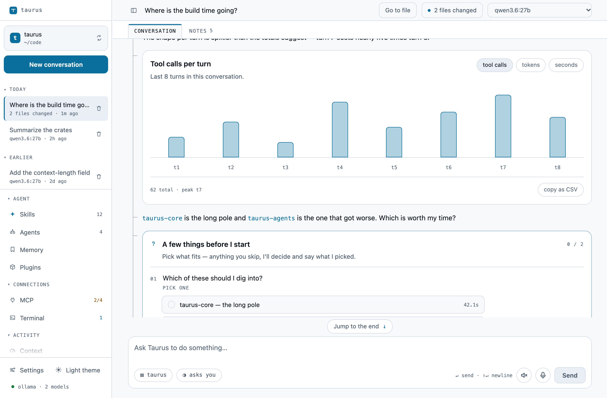 | 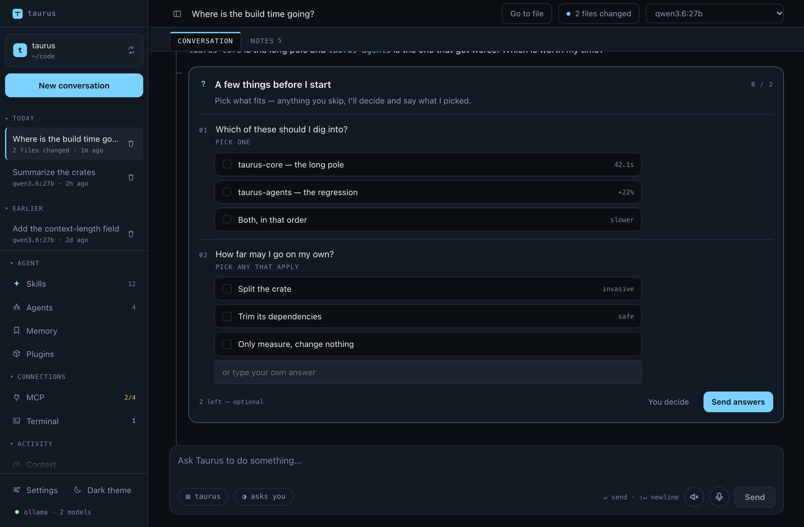 |
| The light theme: a chart with a tab per series, and the pill back to the foot of the conversation. | Questions it waits on. Skip any, or let "You decide" answer them all. |

</details>

<details>
<summary><b>Data</b>: the profile pane</summary>

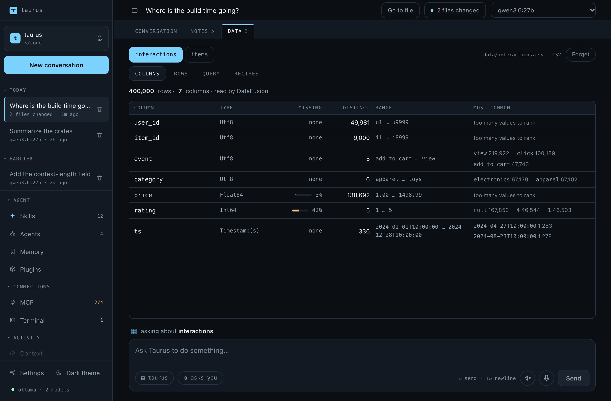

The pane takes the center column beside the conversation instead of covering
it, and only exists once a workspace has loaded something.

</details>

<details>
<summary><b>The canvas</b>: a file beside the conversation, and a conflict</summary>

| | |
|---|---|
| 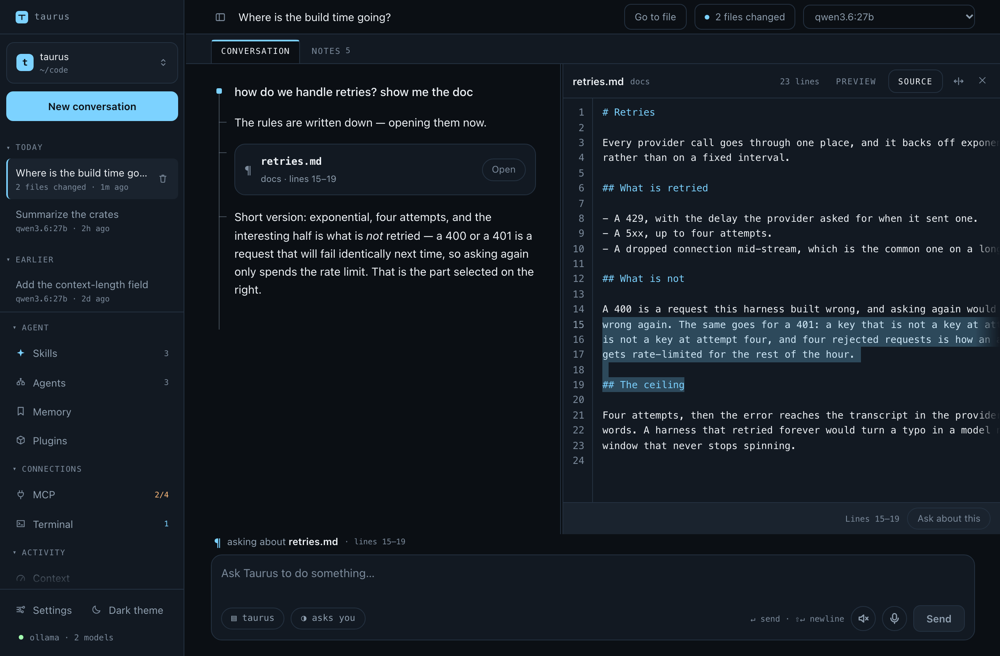 | 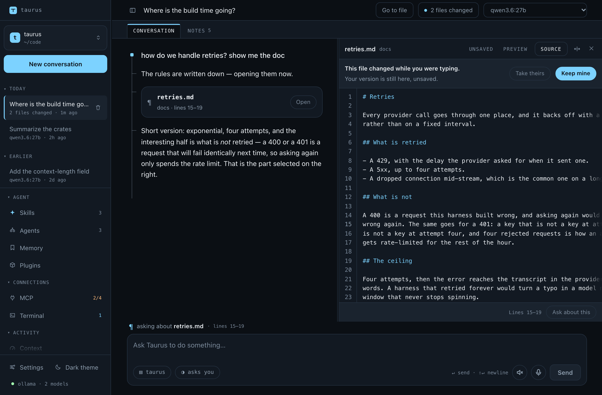 |
| The lines the model pointed at, selected. | Taurus wrote while you typed: both versions kept, neither chosen. |

</details>

<details>
<summary><b>The terminal</b>: command marks and Ask Taurus</summary>

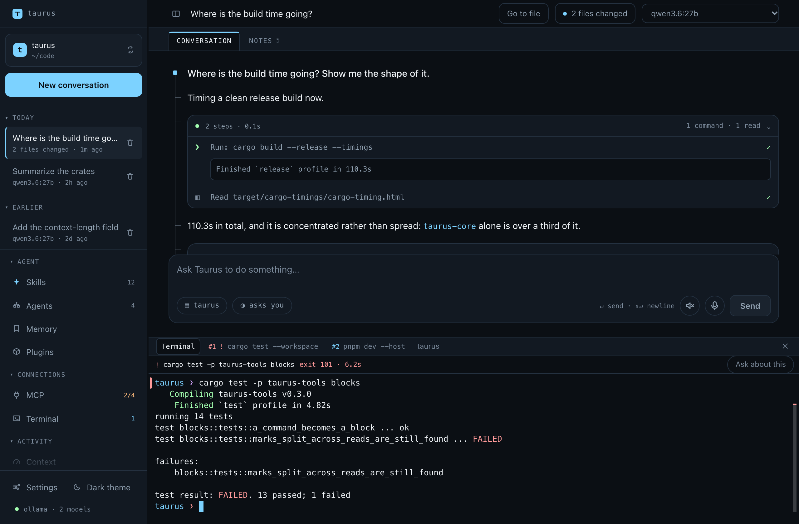

</details>

<details>
<summary><b>Notes and sketches</b></summary>

| | |
|---|---|
| 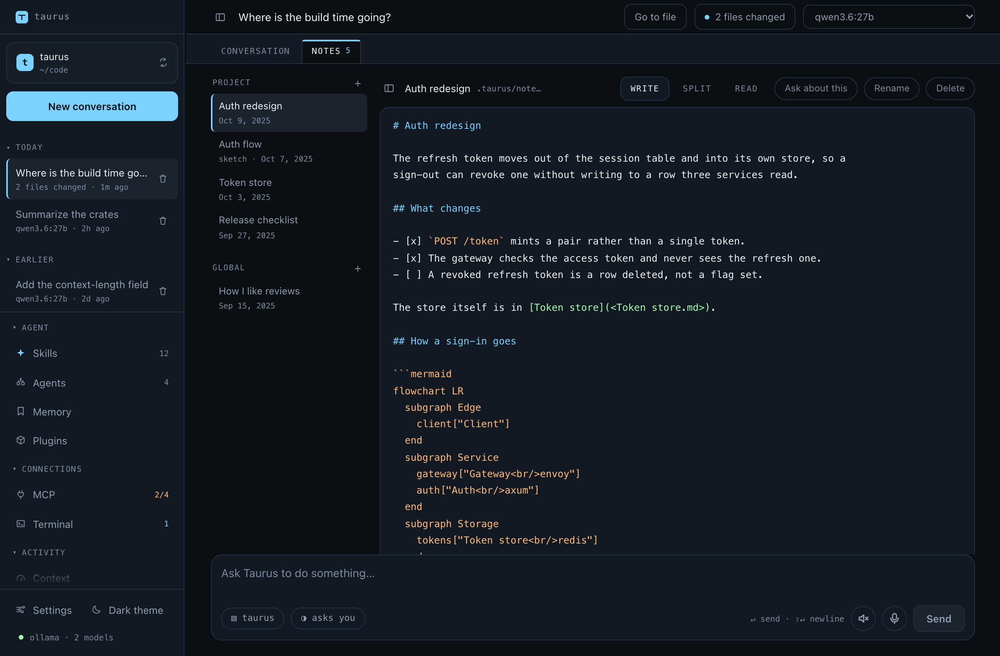 | 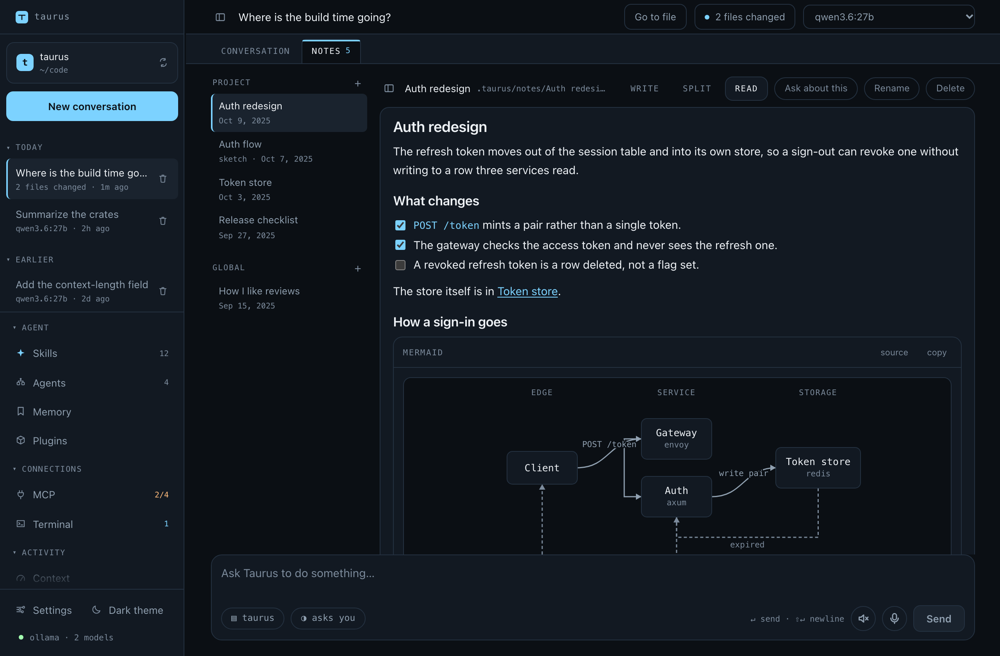 |
| Both notebooks, one note open. | The same note in Read, its Mermaid fence drawn. |
| 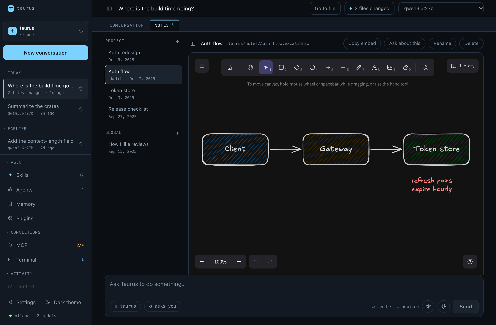 | 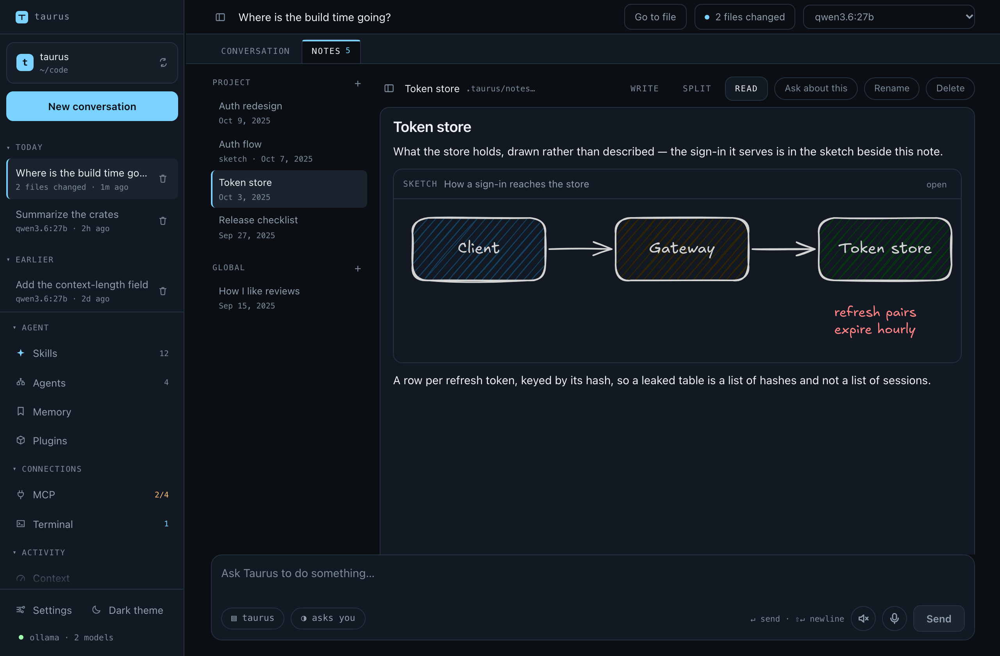 |
| A sketch open beside the notes. | The sketch embedded in a note. |

</details>

<details>
<summary><b>Configuration</b>: MCP servers, appearance</summary>

| | |
|---|---|
| 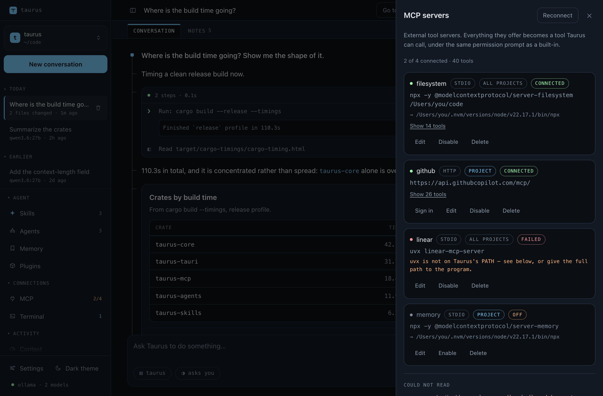 | 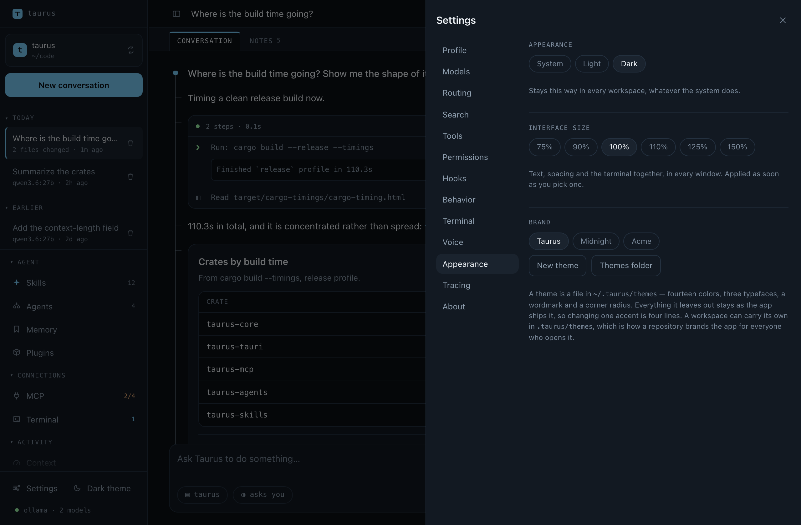 |
| The MCP panel. | Settings, Appearance. |

</details>

<sub>Regenerate these with `pnpm screenshots`. They're the real interface,
driven by fixtures in headless Chrome, not photos of a running window. See
[`scripts/screenshots/`](scripts/screenshots/capture.mjs) for why, and what
that costs.</sub>

## How it is put together

```
crates/
  taurus-provider/          Provider trait + normalized message/stream types
  taurus-provider-ollama/   Ollama adapter (NDJSON, per-model capabilities)
  taurus-provider-openai/   OpenAI-compatible adapter (chat completions, Responses)
  taurus-provider-anthropic/ Anthropic Messages API (probed capabilities, caching)
  taurus-provider-gemini/   Google Gemini (generateContent, OpenAPI-subset schemas)
  taurus-tools/             Tool registry, built-in tools, permission gate, undo
  taurus-skills/            Skill discovery, execution, and authoring
  taurus-agents/            Sub-agent definitions and discovery
  taurus-mcp/               MCP client
  taurus-web/               Web search and page fetching
  taurus-index/             Local semantic search: chunking, embedding, ranking
  taurus-embed/             Embedding models run in-process with candle, and their pinned downloads
  taurus-watch/             Workspace file watching that says what changed or admits it can't
  taurus-lsp/               Language-server diagnostics for what the file tools just wrote
  taurus-data/              Reading, profiling, and transforming tabular files, behind one engine trait
  taurus-voice/             Dictation: microphone capture, whisper.cpp transcription
  taurus-speech/            Reading aloud: the speakable-text filter, voices, playback
  taurus-core/              Session state, the agent loop, sub-agents
  taurus-host/              Config, system prompt, registry assembly
  taurus-cli/               The `taurus` binary
src-tauri/                  Windows and IPC — no agent logic
src/                        React UI
```

One rule holds the design together: **a frontend contains no agent logic.**
Everything a session *is* (config files, system prompt, tool registry, skill
library) lives in `taurus-host`, and `Host::build_agent` is the only place
they come together. The desktop app and the CLI differ only in how they talk to
you: how they ask for permission, and where a skill proposal goes. Both of
those are traits.

That's also why the agent loop can be tested against a scripted provider, and
why the [live checks](docs/development.md#live-checks) run without a GUI.

### Provider-agnostic, concretely

The normalized types use Anthropic-style content blocks, not OpenAI's
`tool_calls` shape. Blocks are the superset. A single assistant turn with
interleaved text, reasoning, and several tool calls survives the round trip.
Going the other direction, it doesn't.

Three things show the abstraction works, instead of just claiming it does:

- **No adapter after the first needed a change to `taurus-core`.** The OpenAI
  one differs in transport (SSE vs NDJSON) and in tool-call encoding
  (arguments as a string assembled across frames vs a whole object). Gemini
  differs in what a conversation even *is*:
  - the assistant is called `model`
  - tool calls carry no ids at all, so results pair with calls by name
  - schemas are an OpenAPI subset, not JSON Schema
  - every streamed chunk is a whole response object, not a delta envelope

  None of that reached the core.
- **Models without tool support still call tools.** `gemma3` doesn't accept a
  `tools` parameter at all. Taurus detects that from Ollama's capability probe
  and switches to prompted tool calling. It parses `<tool_call>` blocks out of
  the text stream into the exact same events a native adapter emits, and
  `taurus-core` can't tell which path a turn took.
- **A backend that can describe itself gets asked, not configured.** Ollama
  and Anthropic both answer questions about their own models. So neither needs
  a `context_length` in `providers.json`, and neither can be told the wrong
  one.

## License

MIT. See [LICENSE](LICENSE).
